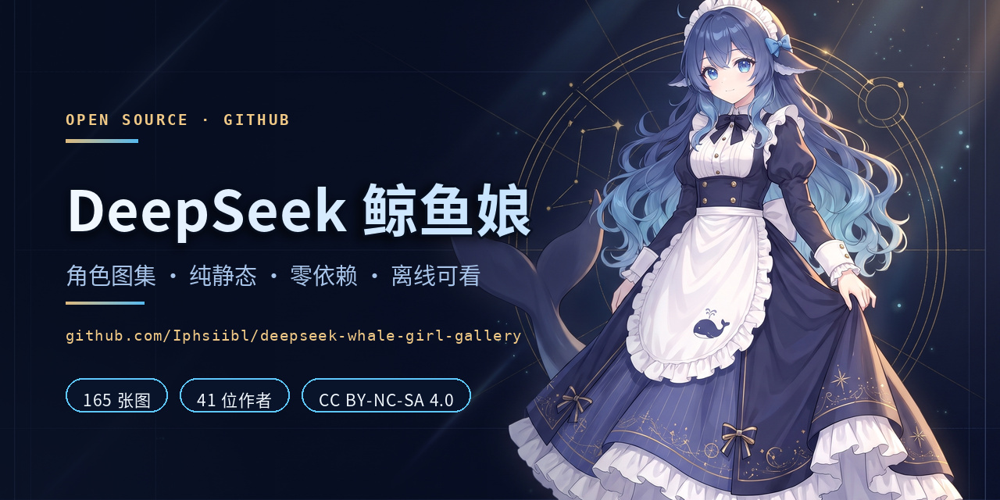

# DeepSeek 鲸鱼娘 · 角色图集



「吃白饭的蓝色大肥鱼」——社区共同养出来的 DeepSeek 拟人形象（鲸鱼娘）角色图集。

## 在线预览

**https://iphsiibl.github.io/deepseek-whale-girl-gallery/**

## 目录结构

```
.
├── README.md           # 本文件
├── LICENSE             # CC BY-NC-SA 4.0 全文（适用于本仓库的整理与页面代码）
├── ATTRIBUTION.md      # 每张图片的作者与出处（CC BY 要求署名）
├── banner.jpg          # GitHub 预览图
├── .github/workflows/  # CI：校验页面与图片一致性
├── tools/
│   ├── make_thumbs.py  # 生成多档展示版 WebP（480 / 960 / 1440 / 1920 宽）
│   ├── import_upstream.py # 从鲸鱼娘开源资产库批量导入社区作品 + 记录出处
│   ├── build_cards.py  # 由出处文件生成页面上的社区卡片
│   ├── build_attribution.py # 由出处文件生成 ATTRIBUTION.md 署名表
│   ├── sync_srcset.py  # 把清单里的档位同步进页面 srcset / data-full
│   ├── check_gallery.py# 校验页面引用、缩略图清单、原图孤儿
│   ├── check_manifest.py # 比对清单结构（不比字节，避开 libwebp 版本差异）
│   ├── verify_browser.py # Playwright 浏览器端验证（功能 / 性能 / 布局 / 无障碍）
│   └── requirements.txt
├── tools/upstream/     # 上游资产库清单快照（可复现导入的基准）
└── docs/               # GitHub Pages 发布根目录
    ├── index.html      # 画廊页面（单文件，内联 CSS/JS）
    ├── .nojekyll       # 关闭 Jekyll 处理，图片原样发布
    ├── thumbs/         # 展示版 WebP（多档，按设备像素比选档）
    ├── sheets/         # 角色设定图原图（Q 版 / 成熟比例三视图）
    ├── moegirl/        # 萌娘百科「DeepSeek娘」条目收录原图
    ├── refs/           # 换装三视图原图
    ├── community/      # 社区二创全集原图
    └── wallpaper/      # 场景壁纸原图
```

## 内容一览

| 分区 | 数量 | 说明 |
| --- | --- | --- |
| 角色设定图 | 2 | Q 版三视图、成熟比例三视图，均附完整生成 Prompt |
| 萌娘百科收录图 | 6 | 含流传最广的「女仆鲸鱼娘」原立绘（1152×2048）与条目头图（2732×4096） |
| 换装三视图 | 7 | 黑礼服人鱼 / 简约短裙 / 长裙 / 细节洛丽塔短裙 / Q 版 / 黑绿 / 黑红 |
| 社区二创全集 | 147 | 来自鲸鱼娘开源资产库，41 位作者，逐图署名 + 投稿出处 |
| 场景壁纸 | 3 | 1008×576 静帧 |
| **合计** | **165** | 原图 67.4 MB |

## 角色设定备忘

蓝色渐变长发（发根深海蓝 → 发尾浅青蓝）、头顶呆毛、头侧一对横向展开的**鲸鱼鳍状耳朵**、
深蓝白女仆装（白色蕾丝发箍、深蓝领结 + 椭圆蓝宝石胸针、围裙小鲸鱼刺绣、深蓝玛丽珍鞋）、
身后一条大鲸尾。人设标签为「傲娇嘴甜、聪明但懒、主食白饭、绝对拒绝被叫胖」，管用户叫「鱼片」。

## 形象谱系

1. **2025.06** — B 站 UP「上善无形」AI 创作原创角色「**溟月**」，确立蓝渐变发、呆毛、鲸鳍、鲸尾等基础特征
2. **2026.04** — UP「ZipZipPipe」以 GPT Image 2 融入 DeepSeek 元素，换上深蓝白女仆装，**女仆鲸鱼娘**成型

> 注：该形象并非深度求索官方发布，立绘最初甚至是用竞品模型画的。

## 许可与署名

- 本仓库的**页面代码与整理工作**采用 [CC BY-NC-SA 4.0](LICENSE)（署名 — 非商业性使用 — 相同方式共享）。
- 仓库内的**每一张图片版权归各自作者所有**，许可条件以源站标注为准，详见 [ATTRIBUTION.md](ATTRIBUTION.md)。
- 社区二创全集收录自 [鲸鱼娘开源资产库](https://github.com/TreapGoGo/deepseek-whale-girl)：
  上游明确声明「**收录不把图片变成 MIT 素材**」，每件作品仍按其作者/投稿声明授权，
  逐件记录在 [ATTRIBUTION.md](ATTRIBUTION.md)；上游未标注作者的作品如实记为「作者未知（上游未标注）」，不做推测。
- 整体角色形象源自「溟月」（CC BY-NC-SA 4.0）：需署名、**禁止商用**、衍生作品须以相同协议开放。
- 本仓库为社区同人整理，与深度求索公司无隶属或背书关系。
- 如你是相关权利人并希望移除内容，请提 issue。

## 主要来源

- [鲸鱼娘开源资产库](https://treapgogo.github.io/deepseek-whale-girl/) — 126 张社区画廊、Prompt、ComfyUI 工作流
- [萌娘百科「DeepSeek娘」](https://mzh.moegirl.org.cn/DeepSeek%E5%A8%98) — 条目与图片归档
- [AI 萌图 · 大肥鱼娘三视图设定集](https://aigengtu.com/refs?lang=zh-Hant) — 7 套换装参考
- [dsh-whale-girl-wallpaper](https://github.com/QWEQ-CELL-DEL/dsh-whale-girl-wallpaper) — DeepSeek Harness 社区皮肤壁纸
- [Civitai · DeepSeek 鲸鱼娘 LoRA](https://civitai.red/models/2697171) — Krea 2 / IllustriousXL / Anima 三版本
- [PixAI 作品集](https://pixai.art/uk/artwork/2048994181303798139)
